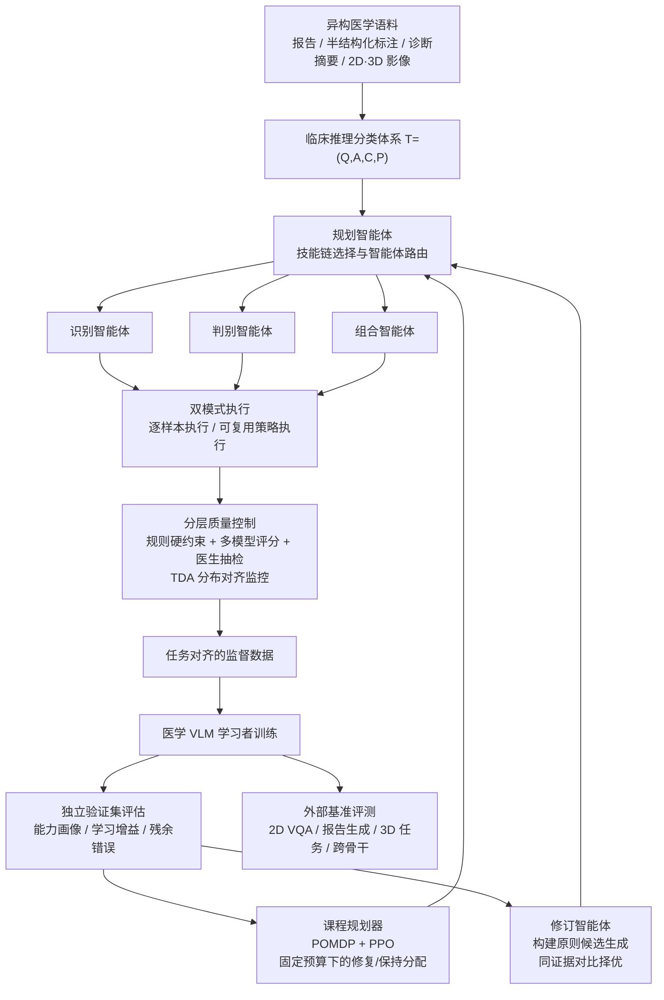

# 毕业论文开题报告

> 本报告基于前期两项工作撰写：
> - **MedSkillFlow**: Liberating Medical Annotation through Autonomous Multi-Agent Orchestration（AAAI 2027 投稿）
> - **CoEvoMed**: Co-Evolving Supervision Principles and Medical Vision–Language Models（ICLR 2027 在审）

---

## 一、论文题目

**面向医学视觉-语言大模型的多智能体自适应监督数据构建方法研究**

（英文：Research on Multi-Agent Adaptive Supervision Construction for Medical Vision–Language Models）

备选题目：

1. 基于多智能体协同的医学多模态大模型训练数据构建与协同演化方法研究
2. 从静态构建到协同演化：医学视觉-语言模型监督数据的多智能体生成方法研究

---

## 二、所属学科和专业

- **所属学科**：工学 — 计算机科学与技术（一级学科）
- **专业**：计算机科学与技术（研究方向：人工智能 / 医学多模态大模型）

> 注：如学院专业目录为"人工智能"或"计算机应用技术"等，请按学校实际专业名称替换。

---

## 三、选题来源

**自选课题**（结合导师科研项目与本人前期研究工作）。

本选题源于本人在医学视觉-语言模型（Medical Vision–Language Models, Medical VLMs）训练数据构建方向上的前期研究：MedSkillFlow 研究了如何利用"临床推理分类体系 + 多智能体技能编排"把异构医学语料转换为与下游任务对齐的高质量监督数据；CoEvoMed 进一步研究了如何让监督数据的构建原则随学习者（模型）能力变化而协同演化，并在固定预算下进行课程分配。本论文将两项工作统一到"医学监督数据自适应构建"这一主线下进行系统研究。

> 注：如有具体的国家自然科学基金、省部级或横向项目支撑，请将"自选课题"替换为对应项目名称及编号。

---

## 四、选题有关的国内外研究综述

### 4.1 医学视觉-语言大模型的发展

近年来，随着通用多模态大模型（如 LLaVA、Qwen-VL、InternVL 系列）的快速发展，医学视觉-语言模型取得了显著进展。国外方面，微软提出的 LLaVA-Med [1] 利用 PubMed Central 中的图文对，通过 GPT-4 自动生成指令跟随数据，以"课程式"两阶段训练在一天内得到生物医学多模态助手，开创了"利用大模型生成医学指令数据"的范式。此后，MedGemma、Med-Flamingo 等模型分别从预训练语料、少样本适配等角度提升了医学多模态理解能力。

国内方面，相关研究同样十分活跃。上海交通大学团队构建了大规模医学视觉问答数据集 PMC-VQA [2]，系统研究了生成式医学 VQA；香港中文大学（深圳）团队提出 HuatuoGPT-Vision [3]，通过对 PubMed 图文数据进行清洗与重格式化构建 PubMedVision 数据集，大幅提升了医学视觉知识注入效果；上海人工智能实验室提出 GMAI-VL 及 GMAI-VL-5.5M [4]，汇集多来源医学数据构建面向通用医学人工智能的综合数据集；浙江大学等单位提出的 Hulu-Med [5] 使用约 1670 万条样本训练全开源医学通用模型，成为当前 32B 以下医学 VLM 的代表性工作。

总体来看，现有工作的主要提升路径有两类：一是**改进模型结构或训练方法**（如引入专家知识、像素级定位、混合专家路由、强化学习推理等）；二是**扩大数据规模与混合比例**。然而，这些工作对"如何将异构医学语料转换为与下游任务、临床能力相一致的监督数据"关注不足，监督构建通常被视为模型训练之外的"工程前置步骤"。

### 4.2 医学多模态监督数据构建

医学监督数据构建面临专家标注成本高、格式异构、临床约束强等困难。现有做法大致包括：

1. **人工/专家标注**：如 VQA-RAD、SLAKE 等数据集依赖放射科医生参与，质量高但难以规模化；
2. **单提示大模型生成**：如 LLaVA-Med [1]、PMC-VQA [2] 使用单一提示由 LLM 生成问答对，容易将格式目标、临床约定与能力覆盖混为一体，产生偏离临床规范的样本；
3. **大规模数据混合**：如 HuatuoGPT-Vision [3]、GMAI-VL [4]、Hulu-Med [5] 通过数据集汇聚与重格式化扩大规模，但监督仍按单个数据集或固定任务组织，各语料之间的格式与能力分布不一致；
4. **规则转换**：成本低但刚性强，难以覆盖多样化任务协议。

本人前期工作 MedSkillFlow 的实验表明，直接使用未经处理的原始混合语料（MedMAT、PubMedVision、MedTrinity-25M）训练 Qwen3-VL-8B，会使 SLAKE 准确率由 64.84% 降至 38.15%，低于基座模型。这说明**数据规模本身并不足以带来性能提升，监督与目标任务分布的对齐才是关键**。

### 4.3 基于大语言模型的智能体与多智能体协作

以 ReAct、AutoGen [6] 为代表的工作建立了大语言模型的规划—行动—协作机制：AutoGen 通过多智能体对话组织复杂任务，Self-Refine、Reflexion 等利用反馈对输出进行迭代修正。在医学领域，MMedAgent [7] 训练多模态智能体调用医学工具，MedRAX 面向胸片进行智能体推理，ReasonMed 利用多智能体生成医学推理数据，MMedAgent-RL 研究多智能体协作的强化学习优化。

这些系统大多面向**推理阶段**（工具调用、诊断推理）或特定专科的文本推理轨迹，较少将多智能体协作用于**训练监督数据的系统化构建**，更缺乏以临床能力体系为控制接口的技能编排与可复用执行策略。

### 4.4 课程学习与学习者反馈驱动的自适应监督

课程学习 [9] 提出按难度由易到难组织训练样本；教师-学生课程学习 [10] 进一步依据学习进度（learning progress）动态选择任务，将课程选择建模为序贯决策问题。近期，DataEnvGym [8] 构建"教师环境"，让数据生成智能体根据学生模型反馈迭代生成训练数据；R-Zero、ACE 等工作探讨了自演化推理与上下文迭代优化。

然而，现有方法多数仅调整"选哪些数据"或"生成多少数据"，而**构建数据所依据的原则（如问题意图、证据—答案关联、概念区分）通常是固定的**。本人前期工作 CoEvoMed 的实验发现：原始构建原则在训练早期（R2）在 VQA-RAD 上领先演化原则 4.22 个百分点，而在训练后期（R5）演化原则反超 8.26 个百分点，说明**监督构建原则的有效性依赖于学习者所处的训练阶段**，需要随学习者能力协同演化。

### 4.5 研究现状总结

综上，现有研究存在以下不足：

1. **监督构建与学习问题相分离**：数据构建独立于模型需要掌握的临床能力，模型需同时承担格式异构、临床歧义与能力覆盖三重负担；
2. **构建过程缺乏结构化与可复用性**：单提示逐样本生成成本高、一致性差，规则转换又过于刚性；
3. **监督是静态的**：构建原则与课程分配不随学习者能力变化而调整，无法及时响应模型的能力短板与能力退化；
4. **质量保障不足**：大规模自动生成易引入不被图像或来源支持的医学陈述，缺乏系统的分层验证机制。

### 主要参考文献

[1] Li C, Wong C, Zhang S, et al. LLaVA-Med: Training a large language-and-vision assistant for biomedicine in one day[C]//Advances in Neural Information Processing Systems (NeurIPS), 2023, 36: 28541-28564.

[2] Zhang X, Wu C, Zhao Z, et al. Development of a large-scale medical visual question-answering dataset[J]. Communications Medicine, 2024, 4(1): 277.

[3] Chen J, Gui C, Ouyang R, et al. Towards injecting medical visual knowledge into multimodal LLMs at scale (HuatuoGPT-Vision)[C]//Proceedings of the 2024 Conference on Empirical Methods in Natural Language Processing (EMNLP), 2024: 7346-7370.

[4] Li T, Su Y, Li W, et al. GMAI-VL & GMAI-VL-5.5M: A large vision-language model and a comprehensive multimodal dataset towards general medical AI[C]//Proceedings of the AAAI Conference on Artificial Intelligence, 2026, 40: 23177-23185.

[5] Jiang S, Wang Y, Song S, et al. Hulu-Med: A transparent generalist model towards holistic medical vision-language understanding[J]. arXiv preprint arXiv:2510.08668, 2025.

[6] Wu Q, Bansal G, Zhang J, et al. AutoGen: Enabling next-gen LLM applications via multi-agent conversation[J]. arXiv preprint arXiv:2308.08155, 2023.

[7] Li B, Yan T, Pan Y, et al. MMedAgent: Learning to use medical tools with multi-modal agent[C]//Findings of the Association for Computational Linguistics: EMNLP 2024, 2024: 8745-8760.

[8] Khan Z, Stengel-Eskin E, Cho J, et al. DataEnvGym: Data generation agents in teacher environments with student feedback[C]//International Conference on Learning Representations (ICLR), 2025: 53480-53507.

[9] Bengio Y, Louradour J, Collobert R, et al. Curriculum learning[C]//Proceedings of the 26th International Conference on Machine Learning (ICML), 2009: 41-48.

[10] Matiisen T, Oliver A, Cohen T, et al. Teacher-student curriculum learning[J]. arXiv preprint arXiv:1707.00183, 2017.

---

## 五、选题的理论意义、实际意义和创新点

### 5.1 理论意义

1. **将监督构建纳入学习问题本身**。本研究主张在大规模预训练模型时代，训练数据的构建不应只是模型训练之外的工程前置环节，而应是所求解科学问题的内生组成部分。通过将临床推理要求编码为数据合成的结构先验，把原本由模型优化承担的"格式异构—临床歧义—能力覆盖"等能力层面难题前移、分解到数据阶段，由专门智能体协同解决，为"以数据为中心的医学人工智能"提供新的理论视角。
2. **建立监督与学习者的协同演化框架**。本研究将课程分配建模为有限时域部分可观测马尔可夫决策过程（POMDP），将构建原则的修订建模为由学习响应驱动的演化算子，从形式上刻画"监督构建—学习者更新—原则修订"的双向反馈闭环，丰富了课程学习与机器教学的理论内涵：不仅调整"教什么、教多少"，还调整"怎么把证据组织成监督"。
3. **为多智能体系统在训练数据生成中的应用提供方法论**。研究以临床推理分类体系作为声明式契约，规范规划智能体的技能路由与执行策略，探索 LLM 多智能体从"推理时工具"走向"训练时数据生产者"的可控性、可审计性与可扩展性问题。

### 5.2 实际意义

1. **显著降低医学数据标注成本**。医学监督数据高度依赖放射科、病理科等专家，人工标注难以规模化。本研究的可复用执行策略可将 50 万样本的构建开销由约 5 亿 LLM tokens 降至约 0.35 百万 tokens，估算成本降低约 947–1000 倍，为医疗机构和科研团队快速构建专科数据提供可行途径。
2. **以更少数据获得更强的医学模型**。前期实验表明，MedSkillFlow 仅用 300 万条样本（约为 Hulu-Med 的 1/5.6）即在 6 个基准中的 5 个上与之持平或超越；8B 模型超过 Lingshu-7B 至少 5.6 个百分点，32B 模型在四个 VQA 基准上超过所有参评的闭源商业模型。CoEvoMed-8B 在四个 2D VQA 基准上超过 Hulu-Med-7B 1.15–4.80 个百分点，并在 3D 识别、问答与报告生成上取得领先。这对算力与数据资源有限的医院、高校具有直接价值。
3. **提升临床可信度**。分层质量控制（确定性规则硬拒绝 + 多 LLM 合理性评估 + 临床医生抽检）以及证据一致性验证，可减少不被影像或来源支持的医学陈述，在报告生成上提高临床实体准确率（RaTEScore），为医学 AI 的安全落地奠定数据基础。
4. **方法具备通用性**。框架在 Qwen3-VL、Gemma-3、InternVL3 等不同骨干模型以及 2D/3D 不同影像模态上均验证有效，可推广至眼科、皮肤科、病理等其他专科场景。

### 5.3 创新点

1. **提出临床推理分类体系引导的多智能体技能编排方法（静态构建层）**。将目标任务形式化为可执行规范 T = (Q, A, C, P)（查询族、答案规范、能力标签、目标分布），作为规划智能体的控制接口；将数据处理分解为问题重构、答案规范化、领域适配、干扰项生成、报告构建、思维链增强等 6 个可复用认知技能，由识别、判别、组合三类执行智能体完成，避免单次生成同时满足多目标导致的"注意力坍缩"。
2. **提出"逐样本执行 + 可复用策略执行"的双模式机制与分层质量控制**。将分类体系条件下的技能链编译为可审计、可修订的可复用变换策略，在保证一致性的同时实现约三个数量级的成本下降；以确定性规则硬约束与多模型合理性评分构成分层质量门控，并用基于 Jensen–Shannon 散度的任务分布对齐度（TDA）监控语料整体分布偏移。
3. **提出监督构建原则与学习者能力协同演化的框架（动态演化层）**。由修订智能体依据学习者在独立验证集上的残余错误语义提出候选原则，并在"相同医学证据、相同配额"下对比当前与候选原则生成的监督在事实一致性与任务对齐上的差异，择优保留，实现构建原则随训练阶段自适应演化。
4. **提出学习进度驱动的课程分配策略**。在固定任务级预算约束下，将能力单元间的构建份额分配建模为 POMDP，以行为克隆初始化、PPO 优化课程规划器，以有符号的验证增益为奖励，同时兼顾薄弱能力的"修复"与已掌握能力的"保持"，缓解多任务训练中的能力退化。
5. **从"静态对齐"到"动态协同"的统一研究体系**。将上述两层方法统一为"分类体系约束下的可控构建 + 学习响应驱动的协同演化"的完整技术路线，系统覆盖 2D/3D 医学 VQA 与报告生成任务。

---

## 六、所要解决的主要问题及研究途径与方法

### 6.1 所要解决的主要问题

**问题一：异构医学语料如何高效、可控地转换为与目标任务对齐的监督数据？**
医学语料包括自由文本放射报告、半结构化标注、诊断摘要等多种格式，直接用作监督会损害模型性能。需要解决：如何形式化表达目标任务的格式、能力与分布要求；如何将复杂的转换过程分解为可组合、可复用的操作；如何在规模化的同时保证一致性与较低成本。

**问题二：如何保证自动构建的医学监督数据的临床可靠性与分布合理性？**
大规模自动生成可能引入与来源不一致、格式错误或临床不合理的内容，且可复用策略一旦出错会批量传播错误。需要解决：样本级的分层质量控制，以及语料级的分布对齐监控。

**问题三：如何使监督构建随学习者能力的变化而自适应演化？**
训练过程中，模型对不同能力的掌握程度与学习增益不均衡地变化，固定的构建原则在不同阶段的适用性不同。需要解决：如何从学习响应中诊断能力缺陷、如何据此修订构建原则、如何在受控条件下可靠地评估与选择修订。

**问题四：在有限构建预算下，如何在不同能力之间合理分配构建资源？**
需要在修复薄弱能力与保持已有能力之间取得平衡，避免顾此失彼导致的能力退化，并在任务级配额约束下最大化累计验证增益。

### 6.2 研究途径与方法

#### 研究内容一：临床推理分类体系引导的多智能体监督构建（对应问题一、二，基于 MedSkillFlow）

1. **临床推理分类体系设计**：依据临床能力要求，将每个目标任务编码为 T = (Q, A, C, P)：Q 规定开放式、封闭式、多选、报告类等查询族及结构约束；A 规定答案类型、规范术语、粒度与报告章节；C 规定解剖定位、病变识别、模态判读等能力标签；P 规定能力、查询类型、答案形式、临床意图等可观测维度上的目标边缘分布。
2. **多智能体技能编排**：构建技能库 S = {s1,…,s6}；规划智能体（Orchestrator）根据分类体系、源样本与能力诊断信号，为每个样本选择有序技能链并路由至识别/判别/组合执行智能体。
3. **双模式执行**：逐样本执行保留细粒度控制；对共享同一规范与源格式的样本，由 LLM 将技能规范与代表样本编译成可复用的变换策略，再确定性地批量执行（借鉴 Program-of-Thoughts、Code-as-Policies 思想）。
4. **分层质量控制与分布监控**：确定性规则（由 T 实例化）作硬拒绝，多 LLM 合理性评分设阈值 τ；以 TDA = 1 − Σ w_d · D_JS(P_d^gen ‖ P_d^T) 监控语料分布；辅以临床医生抽样审核。
5. **能力感知的自改进闭环**：每轮训练后估计各能力的下游表现 ρ(c)，将低于阈值的能力集合 W 反馈给规划智能体进行定向增广，直至 W 为空或达到最大轮数。

#### 研究内容二：监督构建原则与学习者的协同演化（对应问题三，基于 CoEvoMed）

1. **学习者状态刻画**：在按任务划分的独立验证集上，通过能力评估泛函 J_c 得到能力画像 κ̂；对同一验证样本比较相邻轮次预测，区分"已修复缺陷、已有能力退化、持续性缺口"。
2. **多智能体监督构建**：证据选择智能体从共享支撑集中检索视觉证据与事实；监督构建智能体按当前构建原则 Σ 生成问答对或报告；证据验证智能体检查事实一致性、视觉依赖性、有效性与重复性，保留证据与原则溯源信息。
3. **构建原则演化**：以"演化窗口"为单位，对使用充分但净修复（修复数 − 退化数）非正的原则，由修订智能体依据残余错误语义（如定位错误 → 强化区域证据与答案的关联）提出候选；在相同证据、相同配额下比较当前与候选原则，以事实一致性、任务对齐度、可用产出率与配对覆盖率为筛选标准，择优更新 Σ_{e+1} = E(Σ_e, h_{e+1}, S)。

#### 研究内容三：学习进度驱动的课程分配（对应问题四，基于 CoEvoMed）

1. **序贯决策建模**：将各轮构建份额分配建模为有限时域 POMDP，状态包括学习者参数、活跃原则、修订历史与剩余资源，目标为最大化折扣累计验证增益。
2. **奖励设计**：奖励 r_e 对 VQA 任务与报告生成任务的验证增益等权平均，保留正负号以同时反映进步与退化。
3. **策略学习**：以行为克隆初始化课程规划器，再用 PPO + GAE 在与学习者的在线交互中优化；分配映射在任务级固定配额内重新分配各能力单元的份额，兼顾"修复"与"保持"。

#### 研究内容四：实验验证与分析

1. **数据**：构建语料包括 MedMAT、PubMedVision、MedTrinity-25M 等；严格进行 QA、报告、全文、图像路径、图像重复与高频模板等多维度去污染检查。
2. **评测基准**：2D 医学 VQA（VQA-RAD、SLAKE、PMC-VQA、PathVQA，指标为准确率）；放射报告生成（MIMIC-CXR、IU-Xray，指标为 BLEU、ROUGE-L、METEOR 与临床实体指标 RaTEScore）；3D 任务（M3D-VQA、3D-RAD、AMOS-MM）。
3. **模型**：以 Qwen3-VL-8B/32B 为主要学习者，以 Gemma-3-4B、InternVL3-9B 验证跨骨干适用性；对比闭源商业模型、通用 VLM 与医学 VLM（Lingshu、HuatuoGPT-V、MedGemma、Hulu-Med 等）。
4. **消融与机制分析**：数据规模、原始数据对照、智能体数量、自改进轮次、阶段贡献分解；反馈来源（历史 vs. 当前）、原始 vs. 演化原则在不同训练阶段的效用；能力轨迹分析与构建成本分析。

### 6.3 技术路线

技术路线可概括为"**静态可控构建 → 动态协同演化 → 系统实验验证**"三个阶段：

1. **第一阶段（静态可控构建）**：以临床推理分类体系为控制接口，通过多智能体技能编排与双模式执行，把异构语料转换为任务对齐的高质量监督，并用分层质量控制与 TDA 保证样本级与语料级质量，形成可控、可扩展、低成本的基础构建能力。
2. **第二阶段（动态协同演化）**：在基础构建能力之上，引入学习者反馈闭环：一方面由修订智能体根据残余错误演化构建原则，回答"如何构建"；另一方面由课程规划器根据学习进度分配构建预算，回答"在哪里投入"，使监督内容与分配共同随学习者能力演化。
3. **第三阶段（系统实验验证）**：在 2D/3D 医学 VQA 与报告生成的多个公开基准上，进行跨规模（8B/32B）、跨骨干（Qwen/Gemma/InternVL）的对比实验，并通过消融与机制分析验证各模块的有效性与互补性，最终形成完整的医学多模态监督自适应构建方法体系。

### 6.4 预期成果

1. 形成一套面向医学视觉-语言模型的多智能体自适应监督数据构建方法，并完成学位论文撰写；
2. 训练得到在多个医学多模态基准上具有竞争力的 8B/32B 医学视觉-语言模型；
3. 发表/投稿高水平学术论文 2 篇（MedSkillFlow、CoEvoMed）。
